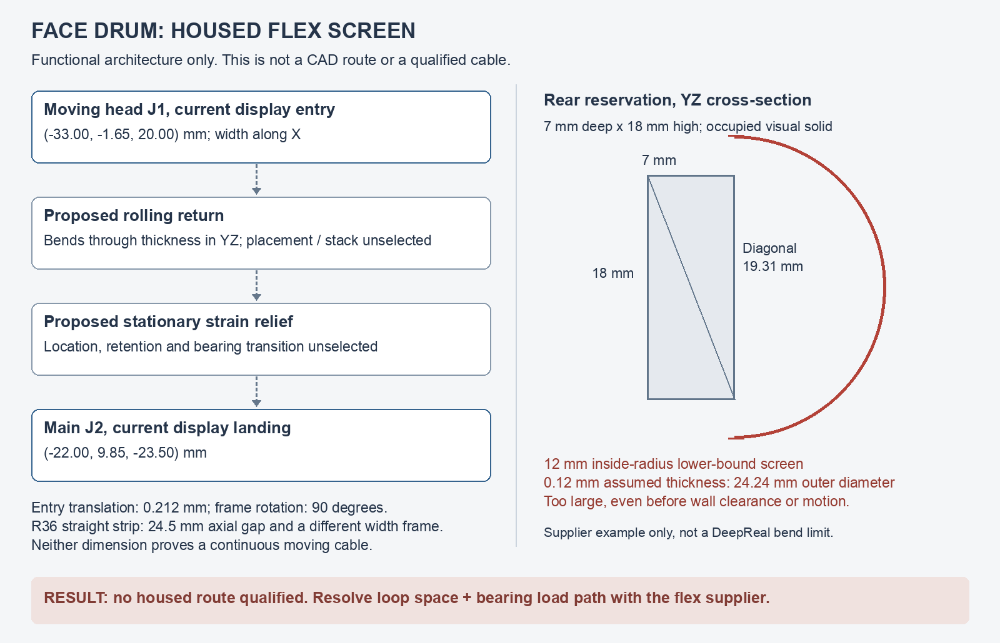

# Face-drum housed-flex checkpoint, 13 October 2026

Status: **conditional stage 2 screen delivered; housed routing remains blocked.**

This pass measures the installed face-head proxy endpoints and screens one
rolling-return architecture. It does not move connectors, cut the housing,
redesign the bearing/carrier or change electronics. The
[stage 1 audit](optical-module-interface-checkpoint-2026-10-13.md) is retained
as its earlier phase-end snapshot; current stage status is in the
[roadmap](../system-architecture/device-integration-workplan-2026-10-09.md).
Stage 3 cannot start as an interface freeze.

## Finding

No housed moving cable is qualified. The current head connector and R36's
short bearing-exit strip do not define one continuous cable. The R37 rear
reservation is occupied visual solid, intersects the bearing support at its
passage, and is too small for the recorded supplier bend example with the
chosen loop orientation.

This rejects that reservation/topology combination, **not every possible cable
architecture**. Smaller radii cannot be selected just to make the diagram fit:
supplier construction, electrical performance and cycle life are still unknown.



## Measured endpoints and the missing transition

The [machine-readable report](face-housed-flex-study-2026-10-13.json) uses the
R36 source and installed assembly with their recorded hashes. Coordinates are
world millimetres: X along the drum axis, +Y toward the rear, +Z upward.
The face range remains a provisional −45° to +45°, not a released travel limit.

| Item | Measurement or meaning |
| --- | --- |
| Face pivot | (−28.75, −1.50, 20.00) mm; rotation about X. |
| Current head J1 display entry | (−33.00, −1.65, 20.00) mm; broad ribbon width along X. |
| Current main J2 display landing | (−22.00, 9.85, −23.50) mm; stationary in this study. |
| Entry motion | Radius 0.150 mm about the axis; 0.212 mm displacement between the two travel extremes. The entry frame still rotates 90° across that range. Small translation is not small cable deformation. |
| R36 straight strip | X −8.5 to −2.2 mm, centred on Y −1.5 / Z 20 mm; width along Z at zero pose. There is a 24.5 mm axial gap from the current display entry to its nearest end, plus a different ribbon frame. |
| Bearing neck/lip | Nominal bore radius 8.45 mm, neck outer radius 8.90 mm, rotating lip inner radius 9.15 mm. The 0.25 mm neck/lip radial space is before tolerances. |
| Rectangular strip screen | A hypothetical 15.6 × 0.2 mm cross-section has corner radius 7.8006 mm, leaving approximately 0.6494 mm to that nominal bore. This is not a dynamic, tolerance or bearing approval. |

UV distance recovers the installed ribbon's endpoint sections after glTF vertex
reordering. Nineteen rigid entry poses at 5° intervals were calculated. These
are **endpoint kinematics only**, not a cable sweep or new collision test.
The display entries are not verified exposed-contact or strain-relief datums.
The FH26 conductors-down instruction refers to its PCB/contact side, not a
global downward direction in this assembly.

The earlier
[R36 straight-strip checks](../../blender/refinements/r36/README.md) do not
validate the current display cable. Bridging these frames requires a developed
lead/transition and load path; joining their names or drawing a sharp turn
would not establish continuity.

## One conditional architecture to develop

Use one continuous custom flex, without adding an intermediate connector:

1. A short head-side lead and moving strain relief referenced to J1. Do not let
   the FH26 actuator take repeated cable load.
2. A rolling return that bends through the flex's **thin dimension** in the YZ
   plane, with width along X. Its position, length and moving anchor hardware
   remain unselected.
3. A stationary strain relief tied to a verified fixed bearing/housing load
   path. It separates the moving section from a fixed tail to main J2.
4. A supported fixed tail with supplier-approved static forming and end
   stiffeners. The route through/around the bearing and divider remains
   unrouted; this diagram does not approve a 90° frame change.

This is a functional partition, not a realizable cable pattern. A constant-length
developed shape, straight connector-entry lengths, moving/fixed attachment
coordinates and the full swept volume must be designed together. The existing
RGB sensor tail is a different, static interface and is not the drum flex.
Motor and stationary angle-sensor harnesses also remain separate.

## Reserved loop space and radius sensitivity

The existing [R37 occupancy report](../../blender/refinements/r37/r37-volume-check.json)
defines the rear reservation as:

- X −26 to −0.2 mm, axial span 25.8 mm.
- Y 13 to 20 mm, depth 7 mm.
- Z 10.5 to 28.5 mm, height 18 mm.

For the chosen width-X/bending-YZ return, even the full YZ diagonal is only
19.31 mm. A semicircular return's outside diameter is twice its inside radius
plus twice its film thickness. Testing a **12 mm lower boundary** with an
assumed 0.12 mm thickness gives 24.24 mm, already larger than that diagonal
without any clearance. Thus merely rotating this return within the YZ plane
cannot make it fit.

[R37](../../blender/refinements/r37/README.md) records Würth Elektronik's
approximately 120 µm single-layer example with inside radius **greater than
12 mm**. The 12 mm calculation is deliberately more permissive. It is a
historical supplier example, not a newly audited manufacturer source, selected
DeepReal stack or universal bend limit.

The sensitivity screen keeps a hypothetical full 15.6 mm trunk, 0.12 mm
dynamic thickness and 0.25 mm clearance per wall. None is a selected dynamic
construction. The remaining YZ diagonal is 18.67 mm:

| Assumed inside radius | Outside return diameter | Diameter-bound result |
| --- | --- | --- |
| 2 mm | 4.24 mm | Not rejected by this necessary bound only |
| 3 mm | 6.24 mm | Not rejected by this necessary bound only |
| 4 mm | 8.24 mm | Not rejected by this necessary bound only |
| 6 mm | 12.24 mm | Not rejected by this necessary bound only |
| 8 mm | 16.24 mm | Not rejected by this necessary bound only |
| 12 mm | 24.24 mm | Rejected |

The bound's maximum inside radius is approximately 9.21 mm. That is a geometric
upper bound for a chord, **not an acceptable bend specification or a fitted
loop**. It omits the rest of the semicircle, straight legs, endpoint rotation,
unstrained length, tolerances and collision clearance. A narrower trunk or
different multilayer stack cannot be assumed to preserve the six differential
pairs, power and control allocation.

Space remains blocked independently of radius: R37 recorded 26 of 27 chamber
samples inside the solid visual enclosure and one outside the curved rear skin.
Its divider passage had four surface contacts with the rear bearing-support
web. Those are retained historical observations, not rerun occupancy tests.
The reservation is not an existing cavity. Cutting it as drawn would require a
replacement bearing load path and wall/skin review.

## Supplier inputs and qualification plan

The report keeps these requirements null rather than substituting display
dimensions:

| Input to obtain | Required content |
| --- | --- |
| Dynamic construction | Selected supplier, layer count, copper/neutral-axis construction, coverlay, moving thickness/width, controlled-impedance references and end stiffeners. |
| Bend and installation rules | Dynamic/static inside radii, permitted torsion, straight entry, anchor spacing, forming method, assembly/service sequence and temperature range. |
| Electrical limits | Numbered continuity/contact views, six differential pairs, SI/lane skew/crosstalk, actual mode/startup/recharge current, voltage drop, return sharing and fault derating. |
| Motion/life requirements | Reviewed travel and stops, speed/acceleration, duty, required cycle count, cable torque budget, retention loads and tolerance stack. The legacy 160-degree requirement remains unresolved. |

Qualification must proceed in this order:

1. **Developed cable and digital motion check.** Model a supplier-supported,
   constant-length flex with actual entry frames, anchors, stiffeners and free
   lengths. Sweep the full face range, with adaptive checks between sampled
   poses, against the carrier/optics, motor, bearing neck/webs, both end rings,
   drum skin, housing, shield and stationary tail. Include self-contact,
   containment, minimum bend radius, torsion and tolerance extremes. The 19
   endpoint poses in this pass do not perform this check.
2. **Unpowered mechanism/retention test.** With selected bearing/support parts,
   measure cable torque, anchor movement, abrasion and actuator load at both
   ends and during reversal. Compare with reviewed drive and retention budgets.
3. **Flex-life and electrical test.** Use the approved travel, speed, temperature
   and cycle target, not the RGB tail's 20 handling bends or FH26's ten mating
   cycles. Monitor opens/shorts, contact resistance and voltage drop; inspect
   delamination/copper damage and retest signal integrity and capture errors.
   Powered projector work remains subject to the separate safety gate.
4. **Interaction-specific study.** Repeat with its actual connector frame,
   optics, support geometry and provisional 0° to 45° range. Face results are
   not symmetry-based approval for the second drum.

## Next bounded decision

Do not advance to mechanical interface freeze. First obtain a dynamic-stack
proposal and decide the bearing/loop module's protected space and stationary
load path. Then develop an isolated moving-lead/return/fixed-tail model.
If no route works with the retained endpoints and enclosure, report the
required bearing, connector or housing changes for review; do not silently
move them or force the expanded display loop into the case.

## Reproduction and checks

From the repository root:

```sh
python3 blender/test_face_housed_flex_geometry.py
blender -b -t 4 blender/refinements/r36/deepreal-inner-bearing-window-r36.blend \
  --python-exit-code 1 --python blender/study_face_housed_flex.py \
  -- --output /absolute/new-face-flex-report.json
```

The script refuses an existing output path. It reads the source/installed
asset hashes, measures in an isolated Blender process and never saves a
`.blend`, exports a GLB or writes an electronics/gate record.

Twelve numerical regressions pass. The successful isolated measurement follows
an initial missing `_WEB` suffix error, which was fixed before saving this
report. The candidate and retained report reproduce the same measurements.
The existing-output refusal test also passes without changing the saved report.
All 209 protected input files remain byte-identical; 20 local links and the
diagram's report-hash metadata pass verification. Python syntax and both
repositories' diff checks pass.

Viewer unit/browser checks were not rerun because the viewer and installed
assets are unchanged. No complete cable collision, fatigue or physical test is
claimed. The stage 1 gaps and main-PCBA fabrication/public-visual restrictions
remain open.
